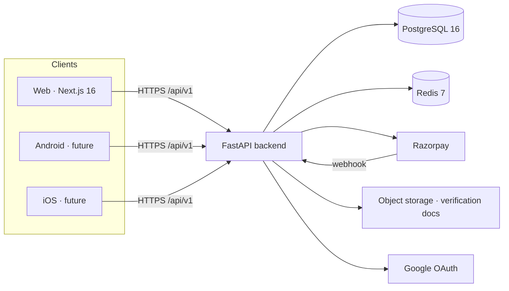
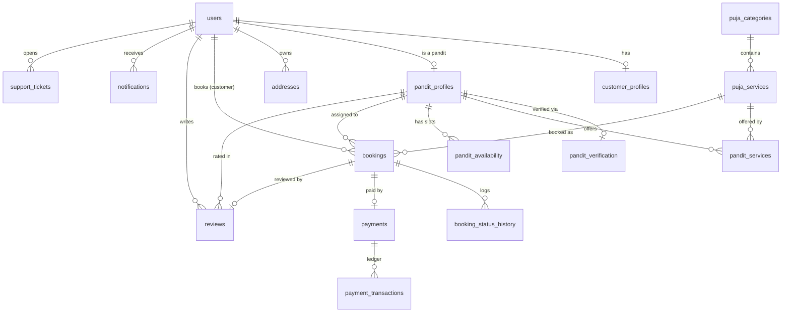
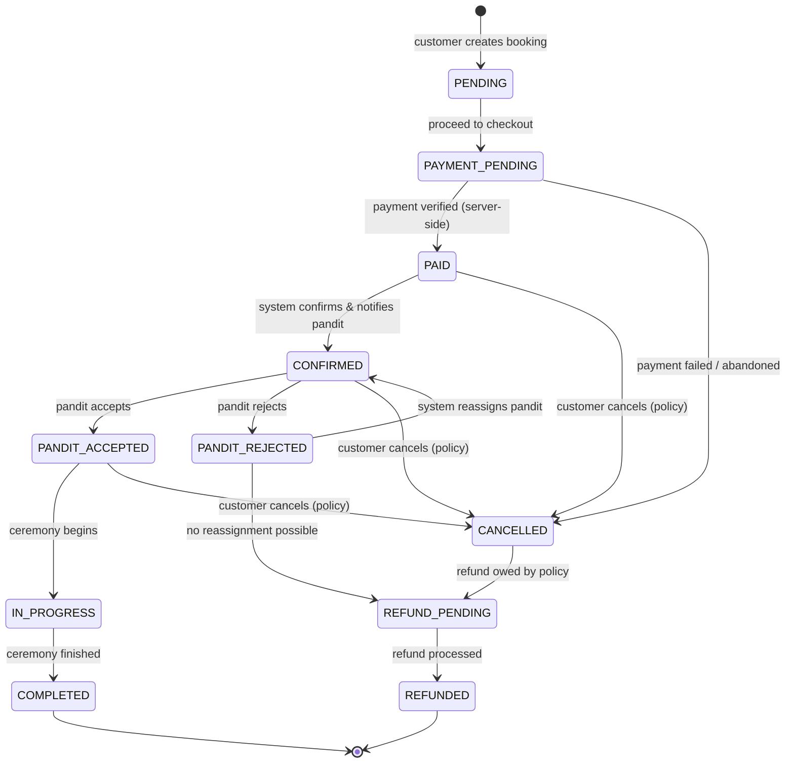

# Purohitdham — Phase 1: Architecture, Design & Development Roadmap

**Status:** ⏸ **FOR REVIEW — no implementation code will be written until you approve this document.**
**Date:** 2026-08-21
**Author:** Lead architect (working session)
**Scope:** System architecture · folder structure · database ER design · API architecture · authentication design · booking state machine · development roadmap · major technical decisions
**Grounding:** Written against the *actual* codebase, cross-checked with `AUDIT.md` (2026-08-21). Every "current state" claim is traceable to a file.

---

## 0. How to read this document

This is the **Phase 1** deliverable your brief asks for: architecture and design only, delivered *before* any further coding, with a stop for your approval at the end.

Two things make this project different from a greenfield build, and this document is written to respect both:

1. **It is brownfield.** Roughly 11,800 lines of real code already exist — authentication, the puja catalogue, the pandit directory, and the admin console all work. So this is not a blank-slate architecture; it is a **target architecture plus a gap analysis** showing what already conforms, what needs rework, and what is net-new. Where the code already does the right thing (and in a few places it does it *well*), the plan keeps it.
2. **You have set a governing quality bar:** the UI must be genuinely good and **mobile-first responsive** across the whole site. That is treated here as a first-class, cross-cutting requirement (§11), not a cosmetic afterthought.

This document **supersedes** the thin stub docs currently in `docs/` (`architecture.md`, `api.md`, `database.md` are 37–66 lines each and partly unwritten). Those per-topic files will be fleshed out as their respective phases land. `booking-flow.md` and `security.md` are the substantive existing docs and are treated as binding except where noted.

Nothing in §5–§9 is built yet unless explicitly marked **`[exists]`**.

---

## 1. Executive summary

Purohitdham is an **API-first Vedic services marketplace**: customers book verified Pandit/Purohit Ji for Hindu religious ceremonies; pandits manage availability and jobs; administrators verify pandits and run the platform. The same backend API must serve the web app today and Android/iOS apps later — so the backend is the product's centre of gravity, and the web frontend is its first client, not its core.

**Where the build actually stands** (detail in §2):

- **Working:** catalogue (10 seeded pujas / 5 categories), pandit directory + GPS onboarding, auth (register/login/Google/refresh/me), admin console (5 pages, 12 endpoints).
- **Absent at every layer:** the customer **booking** flow, **payments**, the **availability** engine, and both the **customer** and **pandit** dashboards. The transaction at the centre of the product does not exist yet.
- **Foundations missing:** **zero** database migrations (schema is created by a dev-only side effect), **zero** tests, no edge route protection, and several security controls that are configured but not wired.
- **UI:** attractive in places but uneven, largely built on hardcoded mock data, bilingual on only 3 of 12 pages, and not reliably mobile-safe (the admin console has no layout below 768px).

**The three things that gate everything else**, in order:

1. **Settle the booking schema and establish migrations.** Three incompatible booking models exist; nothing downstream can be built cleanly until one is chosen and Alembic is in use (§8, §13-D1/D2).
2. **Build the availability engine.** Two steps of the core booking flow have nothing to query today (§5 `pandit_availability`).
3. **Make money work correctly.** Payments are absent, and — more importantly — **commission and payouts do not exist in the specification at all** (§9, §14-Q1/Q2). This is a business decision, not a coding one, and it changes the schema.

The roadmap in §12 sequences the remaining work so each step unblocks the next, with the UI quality bar applied to every phase that ships an interface.

---

## 2. Current state — grounded gap analysis

This is what exists today, by layer. It is deliberately precise so the roadmap rests on facts, not on the (stale, inaccurate) README phase table.

| Area | Built today | Missing / broken |
|---|---|---|
| **Database tables** | 5 of 17: `users`, `pandit_profiles`, `puja_categories`, `puja_services`, `bookings` | 12 tables incl. `payments`, `pandit_availability`, `addresses`, `reviews`, `*_history`, `audit_logs` |
| **Migrations** | Alembic *configured* (`alembic.ini`, async `env.py`) | **0 migrations.** Schema created by `Base.metadata.create_all` in `main.py` lifespan — dev-only, no path to prod |
| **Backend API groups** | `auth`, `pujas`, `pandits`, `admin` (registered in `api/v1/router.py`) | `bookings`, `payments`, `availability`, `reviews`, `users`, `notifications`, `support` |
| **Auth** | register / login / Google OAuth / refresh / me — working | Redis refresh-token rotation, `jti` denylist, rate limiting, route-level edge gate — all configured-but-unwired or absent |
| **Payments** | Nothing. `integrations/` holds only `__init__.py`; `razorpay` not installed | Entire payment subsystem + commission/payout model |
| **Frontend pages** | 15 route files incl. home, `/pujas`, `/pujas/[slug]`, `/pandits`, `/pandit/onboard`, 5 admin pages, login, register | `/booking`, `/pandits/[id]`, all `/dashboard/*`, all `/pandit/*` dashboard pages, `/admin/payments|reviews|support` |
| **Booking (customer)** | Admin-side management only (`admin.py`) | No create path, so admin booking list can only ever be empty. `"Book Pandit Ji Now"` button (`pujas/[slug]/page.tsx`) is decoration — no handler |
| **Data integrity** | — | Homepage shows fabricated pandits & prices from `translations.ts`; `vedic_lineage`/`bio` silently corrupted on register |
| **Tests** | `conftest.py` with one unused fixture | **0 test files**, no frontend test setup |
| **UI/responsive** | Amber Vedic shell now on public pages (Phase-1 UI work) | Admin hidden `<768px`; bilingual on 3/12 pages; native `alert()`/`confirm()`; keyboard-inaccessible controls on the booking path |
| **Deploy** | `docker-compose` (dev mode) | Prod Dockerfiles, `alembic upgrade` on deploy, security headers, `.dockerignore` |

Verified stack: **Frontend** — Next.js 16 · TypeScript · App Router · Tailwind v4 · shadcn/ui. **Backend** — Python 3.11 · FastAPI · SQLAlchemy 2.0 async · Pydantic v2 · Alembic. **Data** — PostgreSQL 16 · Redis 7. **Payments** — Razorpay (planned). **Local** — docker-compose (note: Postgres now published on host port **5433**).

---

## 3. System architecture

### 3.1 Guiding principle — API-first

Every capability is exposed as a versioned REST endpoint under `/api/v1`. The web app, the future Android app, the future iOS app, and the admin panel are all **clients of the same API**. No business logic lives in any client. This is already partly true (the backend owns auth and catalogue logic) and becomes a hard rule going forward.

### 3.2 Backend — clean architecture layers

The dependency rule points inward: outer layers may depend on inner layers, never the reverse.

```
┌──────────────────────────────────────────────────────────────┐
│  Presentation      app/api/v1/*         FastAPI routers        │  HTTP in/out, validation, authz dependencies
├──────────────────────────────────────────────────────────────┤
│  Business logic    app/services/*       use-cases, state rules │  booking state machine, payment verification, availability
├──────────────────────────────────────────────────────────────┤
│  Data              app/models/*         SQLAlchemy 2.0 async    │  ORM models, queries; Alembic owns schema
├──────────────────────────────────────────────────────────────┤
│  Integrations      app/integrations/*   external adapters       │  Razorpay, S3/storage, email/SMS — behind interfaces
├──────────────────────────────────────────────────────────────┤
│  Core              app/core/*           config, security, log   │  JWT, hashing, settings, structured logging
└──────────────────────────────────────────────────────────────┘
```

Routers stay thin: parse, authorize, delegate to a service, shape the response. All non-trivial rules — especially **booking status transitions** and **payment verification** — live in services so they are testable without HTTP and reusable by any client. External systems sit behind interfaces in `integrations/` so Razorpay (or a storage provider) can be swapped or mocked in tests.

### 3.3 Frontend — layers

```
Presentation   src/app/** (Server Components for reads; Client Components for interaction)
Feature UI     src/components/** (layout, ui = shadcn, vedic, feature-specific)
Data access    src/lib/api/**  (typed client, one module per domain)
State/i18n      src/contexts/**, src/lib/i18n/**
```

Components never talk to the database or embed business rules; they call `lib/api`, which is the single boundary to the backend. Reads should prefer Server Components; interactive/mutating views use a data-fetching library (see §13-D8) rather than the hand-rolled `useEffect` fetching that exists on all 12 pages today.

### 3.4 External systems & topology



**Deployment (each independently deployable, per the brief):** frontend → any Node/edge host (e.g. Vercel); backend → container; PostgreSQL → managed instance; Redis → managed instance. Local development is `docker-compose`, extended so it runs `alembic upgrade head` instead of relying on `create_all`.

---

## 4. Target folder structure

`[exists]` = present today · `[new]` = to be added · `[rework]` = exists but changes.

### Backend

```
backend/
├── alembic/
│   ├── env.py                     [exists]
│   └── versions/                  [rework] currently empty → migrations land here
├── app/
│   ├── api/v1/
│   │   ├── auth.py                [exists]
│   │   ├── pujas.py               [exists]
│   │   ├── pandits.py             [exists]
│   │   ├── admin.py               [exists]
│   │   ├── availability.py        [new]
│   │   ├── bookings.py            [new]
│   │   ├── payments.py            [new]
│   │   ├── reviews.py             [new]
│   │   ├── users.py               [new]
│   │   └── router.py              [rework] register new routers
│   ├── core/                      [exists] config, security, logging, exceptions
│   │   └── permissions.py         [rework] currently dead — implement or delete (§7)
│   ├── models/                    [exists] user, pandit, puja, booking, base
│   │   └── (+ new model files)    [new] payment, availability, address, review, …
│   ├── schemas/                   [exists] (+ new per domain)
│   ├── services/                  [exists] auth/puja/pandit (+ booking, payment, availability) [new]
│   ├── integrations/              [rework] add razorpay.py, storage.py behind interfaces
│   └── main.py                    [rework] drop create_all; keep lifespan lean
└── tests/                         [rework] real suites (§12)
```

### Frontend

```
frontend/src/
├── app/
│   ├── (public)  page.tsx, pujas/, pujas/[slug]/, pandits/, pandits/[id]/  [pandits/[id] new]
│   ├── booking/                    [new] checkout flow
│   ├── (auth)  login/, register/   [exists]
│   ├── dashboard/                  [new] bookings/, profile/, addresses/, reviews/
│   ├── pandit/  onboard/ [exists]  dashboard/ bookings/ calendar/ profile/ earnings/  [new]
│   ├── admin/  [exists 5 pages]    + payments/ reviews/ support/                        [new]
│   └── proxy.ts                    [new] Next 16 edge route protection (replaces middleware.ts)
├── components/
│   ├── layout/   SiteHeader, SiteFooter   [exists]
│   ├── ui/       shadcn                    [rework] use dialog/sonner; prune 12 unused
│   ├── vedic/    LanguageToggle, …         [exists]
│   └── feature/  booking, dashboard widgets [new]
├── lib/api/      client, auth, pujas, pandits, admin [exists] · bookings, payments [rework: dead → wired]
├── lib/i18n/     translations.ts           [rework] remove mock business data; extend to all pages
├── contexts/     auth, language            [exists]
├── hooks/        [new] data-fetching hooks
└── types/        [rework] regenerate booking.ts from backend; adopt ApiError envelope
```

---

## 5. Database ER design

### 5.1 Conventions (applied to every table)

- **Primary keys:** UUID (`uuid4`), not auto-increment integers — safe to expose in URLs/APIs, non-enumerable, merge-friendly across future services. Already the pattern in existing models.
- **Timestamps:** every table has `created_at` and `updated_at` (server-set, `timezone=True`). Append-only log tables have `created_at` only.
- **Enums:** native PostgreSQL enum types (e.g. `booking_status`), not free-text strings — the DB enforces the domain.
- **Foreign keys:** default `ON DELETE RESTRICT`. We do **not** silently cascade-delete bookings/payments when a user or pandit is removed — that would destroy financial and audit records. Soft-deactivation (`is_active`) is used instead of row deletion for users/pandits/pujas. (The current models use `CASCADE`/`SET NULL` in places; §13-D3 corrects this.)
- **Indexes:** every FK is indexed; plus query-driven indexes (e.g. `bookings.status`, `bookings.city`, `puja_services.slug`).
- **Unique constraints:** listed per table (e.g. `users.email`, `pandit_services (pandit_id, puja_id)`, one `reviews` row per `booking_id`).
- **Money:** `NUMERIC(10,2)`, never floats. Amounts are stored in rupees with paise precision.

### 5.2 The 17 tables

`[exists]` tables are live; others are new. Columns below are the design intent, not an exhaustive DDL (that lands with the migrations in the DB phase).

**1. `users`** `[exists]` — identity & auth. `id`, `email` (unique), `phone` (unique, nullable), `password_hash` (nullable for OAuth-only), `full_name`, `role` (enum: CUSTOMER/PANDIT/ADMIN/SUPER_ADMIN), `is_active`, `is_email_verified`, `google_sub` (unique, nullable), timestamps.

**2. `customer_profiles`** `[new]` — customer-specific data kept off the auth row. `id`, `user_id` (FK→users, unique), `default_address_id` (FK→addresses, nullable), `preferred_language` (hi/en), timestamps.

**3. `pandit_profiles`** `[exists, rework]` — the pandit's public identity. `id`, `user_id` (FK→users, unique), `display_name`, `bio`, `experience_years`, `vedic_lineage`, `languages` (JSONB/array), `base_city`, `base_latitude`, `base_longitude`, `service_radius_km`, `verification_status` (enum), `rating_avg`, `rating_count`, `is_available`, timestamps. *(Rework: `verification_status` is driven by table 4; ratings maintained from table 14.)*

**4. `pandit_verification`** `[new]` — verification workflow & documents. `id`, `pandit_id` (FK→pandit_profiles), `status` (enum: REGISTERED/DOCUMENTS_SUBMITTED/UNDER_REVIEW/VERIFIED/REJECTED/SUSPENDED), `documents` (JSONB — **private** storage keys, never public URLs), `reviewer_id` (FK→users, nullable), `review_notes`, `reviewed_at`, timestamps.

**5. `puja_categories`** `[exists]` — `id`, `name`, `slug` (unique), `description`, `icon`, `sort_order`, `is_active`, timestamps.

**6. `puja_services`** `[exists]` — the catalogue item. `id`, `category_id` (FK→puja_categories), `name`, `slug` (unique), `description`, `duration_minutes` (drives availability slot sizing), `base_price` `NUMERIC(10,2)`, `samagri_included`, `image_url`, `is_active`, timestamps.

**7. `pandit_services`** `[new]` — which pujas a pandit performs (M:N join). `id`, `pandit_id` (FK), `puja_id` (FK), `custom_price` (nullable override), **unique `(pandit_id, puja_id)`**. This is what makes "find available pandits *for this puja*" answerable.

**8. `pandit_availability`** `[new]` — the availability engine's data. `id`, `pandit_id` (FK), `day_of_week` (0–6, for recurring weekly) *or* `specific_date`, `start_time`, `end_time`, `is_recurring`, `is_blocked` (for holidays/time-off), timestamps. Slot generation projects these onto concrete dates, sized by `puja_services.duration_minutes`, minus existing bookings.

**9. `addresses`** `[new]` — reusable customer addresses. `id`, `user_id` (FK), `label` (Home/Temple/…), `line1`, `line2`, `city`, `state`, `pincode`, `latitude`, `longitude`, `is_default`, timestamps.

**10. `bookings`** `[exists, rework]` — the central transaction. Keeps the existing **denormalised, domain-rich** shape (§13-D1): `id`, `booking_number` (unique), `customer_id` (FK→users), `puja_id` (FK→puja_services, RESTRICT), `pandit_id` (FK→pandit_profiles, nullable), `booking_date`, `muhurat_time`, denormalised venue (`venue_address`, `city`, `state`, `pincode`, `latitude`, `longitude`), `package_name`, `yajman_name`, `gotra`, `special_requests`, `samagri_included`, **`status` (enum extended 7→11)**, and the **new money split**: `total_amount`, `platform_fee`, `pandit_amount`, `dakshina_amount`. `admin_notes`, timestamps. *(Rework: extend enum, add the four fee columns — requires a migration.)*

**11. `booking_status_history`** `[new]` — append-only audit of every transition. `id`, `booking_id` (FK), `from_status`, `to_status`, `changed_by` (FK→users, nullable = system), `reason`, `created_at`. Written on every state change by the booking service.

**12. `payments`** `[new]` — one payment intent per booking. `id`, `booking_id` (FK, unique), `amount` `NUMERIC(10,2)`, `currency` (INR), `status` (enum: PENDING/SUCCESS/FAILED/REFUNDED), `gateway` (razorpay), `gateway_order_id`, `gateway_payment_id`, `gateway_signature`, `method`, `captured_at`, timestamps.

**13. `payment_transactions`** `[new]` — the money ledger + **webhook idempotency**. `id`, `payment_id` (FK), `type` (charge/refund), `amount`, `gateway_event_id` (**unique** — dedupes repeated webhooks), `gateway_payload` (JSONB), `status`, `created_at`. Every gateway event appends a row; nothing is ever overwritten.

**14. `reviews`** `[new]` — `id`, `booking_id` (FK, **unique** — one review per completed booking), `customer_id` (FK), `pandit_id` (FK), `rating` (1–5), `comment`, `is_published`, timestamps. Aggregates maintained onto `pandit_profiles.rating_avg/count`.

**15. `notifications`** `[new]` — `id`, `user_id` (FK), `type`, `title`, `body`, `channel` (in-app/email/sms), `is_read`, `related_booking_id` (FK, nullable), `created_at`.

**16. `support_tickets`** `[new]` — `id`, `user_id` (FK), `booking_id` (FK, nullable), `subject`, `description`, `status` (enum: OPEN/IN_PROGRESS/RESOLVED/CLOSED), `priority`, `assigned_admin_id` (FK→users, nullable), timestamps.

**17. `audit_logs`** `[new]` — security/compliance trail for login, booking, payment, and admin actions (required by `security.md`). `id`, `actor_user_id` (FK, nullable), `action`, `entity_type`, `entity_id`, `ip_address`, `user_agent`, `metadata` (JSONB), `created_at`. Append-only; **never** logs passwords, tokens, or payment secrets.

> **Not among the 17: payouts/settlements.** The spec defines no commission, payout, or settlement table. If we settle pandit earnings on-platform (e.g. Razorpay Route), we will need an 18th table `pandit_payouts`. This is deferred to the commission decision in **§14-Q1/Q2** rather than silently invented.

### 5.3 Relationships



Read: a `user` is optionally one `customer_profile` and/or one `pandit_profile` (role decides which). A `booking` always references a customer, a puja, and — once assigned — a pandit; it accrues a status history, at most one payment, and at most one review. A `payment` fans out into a transaction ledger that also serves as the webhook-idempotency guard.

---

## 6. API architecture

### 6.1 Conventions

- **Versioned base:** `/api/v1`. A future breaking change becomes `/api/v2` without disturbing shipped mobile apps.
- **Auth:** `Authorization: Bearer <access_token>` (mobile-friendly). The web client additionally uses an httpOnly refresh cookie; mobile clients hold the refresh token in secure storage and call `/auth/refresh` directly. **The API contract is identical for web and mobile** — this is what keeps it Android-ready.
- **Standard list envelope** (from `api.md`, not yet implemented — §13-D6): `{ "items": [...], "total", "page", "page_size", "total_pages" }`.
- **Standard error envelope:** `{ "detail", "error_code", "fields": {…} }`. One shape, so every client (and every mobile app) parses errors the same way.
- **Status codes:** `201` create, `200` read/update, `204` delete, `400/401/403/404/409/422/429` used precisely (`409` for booking-slot conflicts, `429` for rate limits).
- **Idempotency:** payment webhook and order-create accept/enforce idempotency keys.

### 6.2 Endpoint map

`[exists]` = live today · others are new. Endpoints marked 🔒 require auth; 👑 require ADMIN/SUPER_ADMIN.

**Auth** — `[exists]`
```
POST   /api/v1/auth/register
POST   /api/v1/auth/login
POST   /api/v1/auth/refresh
POST   /api/v1/auth/logout
GET    /api/v1/auth/me                 🔒
POST   /api/v1/auth/google             (OAuth)
```

**Users & profiles** — `[new]` (customer self-service)
```
GET    /api/v1/users/me                🔒
PUT    /api/v1/users/me                🔒
GET    /api/v1/users/me/addresses      🔒
POST   /api/v1/users/me/addresses      🔒
PUT    /api/v1/users/me/addresses/{id} 🔒
DELETE /api/v1/users/me/addresses/{id} 🔒
```

**Pujas & categories** — `[exists]`
```
GET    /api/v1/pujas                   (filter: category, search, city)
GET    /api/v1/pujas/{slug}
GET    /api/v1/categories
```

**Pandits** — `[exists]` (public read) + `[new]` (availability)
```
GET    /api/v1/pandits                 (filter: puja, city/GPS radius, verified)
GET    /api/v1/pandits/{id}
GET    /api/v1/pandits/{id}/reviews
POST   /api/v1/pandits/onboard         🔒 [exists]
```

**Availability** — `[new]` — *the engine the booking flow queries*
```
GET    /api/v1/availability/slots      ?puja_id&date&city|lat,lng  → bookable slots
GET    /api/v1/availability/pandits    ?puja_id&date&time&location → available verified pandits
GET    /api/v1/pandit/availability     🔒 (pandit views own)
PUT    /api/v1/pandit/availability     🔒 (pandit sets recurring/blocked slots)
```

**Bookings** — `[new]` (customer + pandit actions)
```
POST   /api/v1/bookings                🔒 create (→ PENDING/PAYMENT_PENDING)
GET    /api/v1/bookings                🔒 list (mine; role-scoped)
GET    /api/v1/bookings/{id}           🔒 detail (owner/assigned pandit/admin only)
POST   /api/v1/bookings/{id}/cancel    🔒 (policy-driven refund tier)
POST   /api/v1/bookings/{id}/accept    🔒 pandit → PANDIT_ACCEPTED
POST   /api/v1/bookings/{id}/reject    🔒 pandit → PANDIT_REJECTED
POST   /api/v1/bookings/{id}/complete  🔒 → COMPLETED
```

**Payments** — `[new]` — *never trusts the client*
```
POST   /api/v1/payments/create-order   🔒 → Razorpay order for a booking
POST   /api/v1/payments/verify         🔒 HMAC signature + server-side fetch-back
POST   /api/v1/payments/webhook        (Razorpay → us; signature-verified, idempotent)
```

**Reviews** — `[new]`
```
POST   /api/v1/reviews                 🔒 (only on own COMPLETED booking)
GET    /api/v1/pandits/{id}/reviews    (public, published only)
```

**Admin** — `[exists 12 endpoints]` + `[new]`
```
GET/PUT  /api/v1/admin/users           👑 [exists]
GET/PUT  /api/v1/admin/pandits         👑 [exists]  (+ verify workflow)
GET/POST/PUT /api/v1/admin/pujas       👑 [exists]
GET/PUT  /api/v1/admin/bookings        👑 [exists]  (list/status/assign)
GET      /api/v1/admin/payments        👑 [new]
GET/PUT  /api/v1/admin/reviews         👑 [new]     (moderate/publish)
GET/PUT  /api/v1/admin/support         👑 [new]
GET      /api/v1/admin/reports         👑 [new]     (real metrics, not mock)
```

### 6.3 Deviations from the brief's suggested endpoints (flagged, per your instruction)

The brief said to improve on its endpoint names where a better REST design exists, and to explain any change. Three deviations:

1. **`/payments/initiate` + `/payments/verify` → `/payments/create-order` + `/payments/verify` + `/payments/webhook`.** Razorpay's real flow is: create an *order* server-side, the client opens checkout, then we verify by HMAC signature **and** a server-side fetch-back, **and** reconcile asynchronously via webhook. The existing dead frontend stub (`lib/api/payments.ts`) calls `/initiate`; it will be regenerated to match. The webhook path is non-negotiable — it is how we learn about payments the client never reported.
2. **Addresses nested under `/users/me/addresses`** rather than a top-level `/addresses` — they are always owner-scoped, and nesting makes authorization unambiguous for every client.
3. **Availability split into `/availability/slots` and `/availability/pandits`** — steps 5–7 of the booking flow are two distinct questions ("when can this puja happen?" then "who can do it then?"), and the mobile app benefits from being able to ask them separately.

---

## 7. Authentication & authorization design

### 7.1 What exists and is good

- Password hashing, JWT access/refresh minting, and Google OAuth all work.
- The **web token handling is genuinely well done**: `lib/api/client.ts` holds the access token in memory (not `localStorage`, so it resists XSS) and implements a refresh mutex so concurrent 401s trigger a single refresh, not a stampede. This stays.

### 7.2 Token model (target)

- **Access token:** JWT, 15 min (`ACCESS_TOKEN_EXPIRE_MINUTES=15`), carries `sub`, `role`, `jti`.
- **Refresh token:** 7 days (`REFRESH_TOKEN_EXPIRE_DAYS=7`). **Target state (not yet built):** store SHA-256 hash in **Redis**, rotate on every refresh, invalidate the old token, and honour a `jti` denylist so logout and theft-response actually revoke. Today the refresh token is a stateless JWT that survives logout for its full life — §13-D4 fixes this.
- **Transport:** web uses an httpOnly, `Secure` (env-driven), `SameSite` cookie for the refresh token; mobile uses secure device storage. Access token via `Authorization` header for both.

### 7.3 Roles & RBAC

Four roles, already defined in `models/user.py`: **CUSTOMER · PANDIT · ADMIN · SUPER_ADMIN**. Authorization is enforced **server-side** via FastAPI dependencies (`require_authenticated`, `require_roles(...)`, `require_admin`). Ownership checks (a customer may only see *their* bookings; a pandit may only modify *their* profile) live in the service layer.

Two current problems this design resolves:
- **`app/core/permissions.py` is dead** — its helpers depend on a `_get_current_user_stub` that raises `NotImplementedError`; `admin.py` quietly defines its own `require_admin` instead. We will implement `permissions.py` as the single source of truth and delete the duplicate (§13-D5).
- **Frontend route protection is cosmetic** — no `proxy.ts`/`middleware.ts` exists, so the admin bundle loads for anyone and `/pandit/onboard` has no gate. We add a Next 16 **`proxy.ts`** edge gate as defence-in-depth. The FastAPI dependency remains the authoritative check.

### 7.4 Hardening backlog (tracked to Phase 12 / §13)

Rate limiting on login & register (configured as `5/5m` and `3/1h`, but `slowapi` is not installed and nothing enforces them); move the hardcoded `admin@purohitdham.com / Admin@123456` seed out of source into an explicit CLI command + env vars; env-driven `Secure`/`SameSite=Strict` cookies; secure file uploads for verification docs (private storage, signed URLs).

---

## 8. Booking state machine

### 8.1 The problem being resolved

Three incompatible models exist today: the spec defines **11** states (`booking-flow.md`), the frontend has a **dead 11-state** type (`types/booking.ts`, no live importers) with a normalised `address_id` + fee split, and the **live backend** enum (`models/booking.py`) has only **7** states (`PENDING, PAID, PANDIT_ACCEPTED, IN_PROGRESS, COMPLETED, CANCELLED, REFUNDED`) with a denormalised, domain-rich shape (`yajman_name`, `gotra`, `muhurat_time`).

**Decision (§13-D1):** keep the backend's denormalised domain shape (it fits this product), **extend its enum from 7 → the full 11 states**, and **add the fee-split columns** from the frontend model. Then delete the dead `types/booking.ts` and regenerate it from the backend. The four missing states are not cosmetic: without `PAYMENT_PENDING` there is nowhere to hold a booking during checkout; without `REFUND_PENDING` the refund flow has no state to occupy.

### 8.2 The 11 states

`PENDING · PAYMENT_PENDING · PAID · CONFIRMED · PANDIT_ACCEPTED · PANDIT_REJECTED · IN_PROGRESS · COMPLETED · CANCELLED · REFUND_PENDING · REFUNDED`

### 8.3 Transition diagram



### 8.4 Rules

- **Transitions are validated in the booking service.** No endpoint sets `status` directly to an arbitrary value; every change goes through a guarded transition function that rejects illegal jumps (e.g. `CANCELLED → COMPLETED` is impossible) and **writes a `booking_status_history` row**.
- **Refund tiers** (`booking-flow.md`): >48h before → full; 24–48h → 50%; <24h → none. This boundary arithmetic is exactly what §12 prioritises for unit tests.
- **Two spec ambiguities are escalated, not silently coded** (§14-Q3): who drives `PANDIT_REJECTED` (the transition table says "system reassigns", the prose says "customer rebooks"), and what happens to already-captured funds when a paid booking is rejected.

---

## 9. Major spec gaps to resolve (business decisions — I will not silently decide these)

Per your rule ("do not silently make a major business decision — ask me"), these are escalated to §14 rather than resolved in code:

- **Q1 — Commission model.** The spec has no commission rate, no platform-fee field, and no payouts table. A marketplace has to take a cut somewhere. This determines the `platform_fee`/`pandit_amount` columns and whether an 18th `pandit_payouts` table exists.
- **Q2 — Payout mechanism.** Manual off-platform settlement vs. Razorpay Route automated split. Changes the payment integration materially.
- **Q3 — Rejected-booking funds & who reassigns** (see §8.4).
- **Q4 — Cancellation/refund policy confirmation** — the >48h/24–48h/<24h tiers from `booking-flow.md`: confirm these are the real business terms before they are coded and tested.
- **Q5 — GST/TDS handling** on pandit earnings — out of scope for v1, or required for launch?

---

## 10. Security, logging & observability (cross-cutting)

Applied to every phase, not deferred to the end:

- **Transport & headers:** HTTPS everywhere; security headers (HSTS, `X-Content-Type-Options`, `X-Frame-Options`, CSP) added to the frontend (`next.config.ts` is currently the untouched stub) and backend responses.
- **Input validation:** Pydantic v2 schemas validate every request body; SQLAlchemy parameterises all queries (no string-built SQL) → SQL-injection safe by construction.
- **AuthN/Z:** as §7 — server-side RBAC is authoritative; edge `proxy.ts` is defence-in-depth.
- **Payments:** never trust client-reported success; verify by HMAC + server fetch-back + idempotent webhook (§6.3).
- **Secrets:** all via env vars (`config.py` already centralises them); nothing hardcoded; verification documents in private storage with signed, expiring URLs — never public.
- **Rate limiting:** `slowapi` (to be installed) enforcing the configured login/register/general limits.
- **Structured logging:** `core/logging.py` exists; standardise to structured JSON with a request-id. **Never log** passwords, tokens, or payment secrets. Security-relevant events (login, booking, payment, admin action) also write to `audit_logs`.
- **Error handling:** one exception→envelope mapper (`core/exceptions.py`) so clients see `{detail, error_code, fields}` and stack traces never leak.

---

## 11. Mobile-first UI/UX design system & quality bar

This is the governing quality requirement you set, elevated to a first-class concern. The current UI is uneven — attractive shell, but built on mock data, bilingual on only 3/12 pages, with an admin console that has **no layout below 768px** and controls that fail keyboard/screen-reader use on the booking path. The target below applies to every screen we build or rework.

**Design intent (from the brief):** trustworthy · traditional · premium · modern · clean · respectful · easy for older users. Subtle Vedic visual language (the warm amber palette, restrained Om/Swastika motifs) — *not* a generic e-commerce look, and *not* over-decorated.

**Non-negotiables per screen:**

- **Mobile-first, verified at 360 / 768 / 1024 / 1440px.** Layouts are designed for the small screen first and enhanced upward. No screen may be hidden on mobile (fixes the admin `<768px` gap). Touch targets ≥ 44px.
- **Large, readable typography** and a clear type scale — the audience skews older; legibility beats density.
- **One clear primary CTA per screen.** The booking CTA ("Book Pandit Ji Now") is the product's key action and must be a real, obvious, working control — not decoration.
- **Accessible color contrast (WCAG AA)**; every interactive element keyboard-operable with visible focus; status/rating never conveyed by emoji alone (add text). Replaces the current `<div onClick>` tier selector and bare-emoji ratings.
- **Every view handles four states: loading, empty, error, success.** Skeletons for loading, human empty states, inline error recovery.
- **Real components, not hand-rolled:** use the installed shadcn `dialog`/`sonner` (toasts) instead of native `alert()`/`confirm()`; prune the ~12 unused shadcn components.
- **Fully bilingual (English/Hindi)** on every page via the existing `i18n` system, with the language toggle reachable everywhere (currently homepage-only). A Hindi-first user must never fall into an English-only screen (today `/register` does exactly that).
- **Data is real:** no fabricated pandits/prices. The homepage and cards read from the live catalogue/API; seed data is for development only.

This bar is enforced as an explicit acceptance checklist at the end of every UI-bearing phase (§12).

---

## 12. Development roadmap

The roadmap **maps your 14-phase structure onto the real build state.** Phases you listed that are already substantially built are marked accordingly and become *rework/hardening*, not from-scratch work. Sequencing follows the dependency chain (schema → availability → booking → payments → dashboards), because each unblocks the next and nothing gets built twice. **Each phase ends with a review checkpoint and, where it ships UI, the §11 acceptance checklist.**

| Phase | Brief's intent | Plan given real state |
|---|---|---|
| **1. Architecture & design** | Analyze, design, roadmap | **This document.** ⏸ Stop for approval. |
| **2. Project structure & env** | Scaffold | *Mostly exists.* Reconcile: prod-ready `docker-compose` running `alembic upgrade`, `.dockerignore`, env templates. Light. |
| **3. DB models & migrations** | Models + Alembic | **Gate #1.** Baseline migration from the 5 existing models; second migration extends booking enum 7→11 + fee columns + `booking_status_history`; add remaining new tables; drop `create_all`. |
| **4. Auth & authorization** | Secure auth | *Built.* Harden: Redis refresh rotation + `jti` denylist, rate limiting, `permissions.py` fix, admin seed → CLI/env, `proxy.ts` gate, cookie flags. |
| **5. Puja services** | Catalogue | *Built.* Minor: replace homepage mock data with live catalogue; fix admin puja edit bugs. |
| **6. Pandit management** | Profiles + verification | *Mostly built.* Add `pandit_verification` workflow table + admin verify UI; add `pandit_services`; fix `vedic_lineage`/`bio` corruption; make registration transactional. |
| **7. Booking & availability** | Slots + booking | **Gate #2 & #3.** Build `pandit_availability` + slot engine; `bookings` endpoints with the §8 state machine; customer checkout UI + wire the dead CTA; customer `/dashboard/bookings`. End: product works end-to-end *without money.* |
| **8. Payment architecture** | Razorpay | **Gate #4 — needs §14-Q1/Q2 first.** `payments`/`payment_transactions`; Razorpay adapter behind an interface; create-order + verify (HMAC + fetch-back) + idempotent webhook; refund tiers with tests. |
| **9. Customer frontend** | Full customer app | Dashboard (bookings/profile/addresses/reviews), `/pandits/[id]`, reviews; §11 bar throughout. |
| **10. Pandit dashboard** | Pandit app | `/pandit/dashboard|bookings|calendar|profile|earnings`; accept/reject wires `PANDIT_ACCEPTED/REJECTED` (unreachable until now). |
| **11. Admin dashboard** | Admin app | *5 pages built.* Add payments/reviews/support pages; replace mock metrics with real `/admin/reports`; mobile layout for admin; real dialogs. |
| **12. Testing & security review** | Tests + hardening | Prioritise refund arithmetic, state machine, payment verification, the 6 authz scenarios in the brief. Frontend test setup. Full security pass. |
| **13. Production deployment** | Deploy | Prod Dockerfiles (currently run `npm run dev`), `alembic upgrade` on release, headers, independent deploy of FE/BE/DB, CI incl. explicit ESLint (Next 16 doesn't lint on build). |
| **14. Android API readiness** | Mobile-ready API | Confirm parity (bearer auth, stable envelopes, versioning), publish OpenAPI, document mobile auth flow. Largely falls out of §6 if honoured throughout. |

**Two low-dependency wins** can be pulled earlier if you want a demoable product sooner: replacing homepage mock data (Phase 5) and the auth hardening (Phase 4) — neither blocks the booking chain.

---

## 13. Major technical decisions

- **D1 — Booking model: keep backend's denormalised domain shape, extend enum 7→11, add fee columns.** *Why:* the backend's `yajman_name`/`gotra`/`muhurat_time`/denormalised venue fit the domain; the frontend's dead model only contributed the money split. One migration; delete `types/booking.ts` and regenerate from backend. (§8.1)
- **D2 — Alembic is the only schema authority; remove `create_all`.** *Why:* `create_all` in the lifespan works only on a fresh dev DB — no prod path, no column alters. Baseline migration first, then evolve. Also simplify the lifespan's redundant explicit model imports to `import app.models`.
- **D3 — Foreign keys default to `ON DELETE RESTRICT`; use soft-deactivation.** *Why:* cascade-deleting a user must never erase bookings/payments/audit rows. Current `CASCADE`/`SET NULL` usages are corrected in the baseline.
- **D4 — Redis-backed refresh tokens: hash + rotate + `jti` denylist.** *Why:* today's stateless refresh token survives logout for 7 days and can't be revoked; Redis is already provisioned and specified for exactly this.
- **D5 — Implement `core/permissions.py` as the single authz source; delete `admin.py`'s duplicate.** *Why:* the module is currently dead (stub raises `NotImplementedError`) and re-declares its own `Role`; a lone source prevents drift and 500s.
- **D6 — Standard response envelopes** (`{items,total,page,…}` and `{detail,error_code,fields}`) implemented once in `core`. *Why:* every current call site invents its own error handling; one shape keeps web and mobile consistent. Adopt the unused `ApiError` type.
- **D7 — Razorpay behind an `integrations/` interface; verify server-side + webhook.** *Why:* swap/mockability and the security rule that payment success is never trusted from the client.
- **D8 — Adopt a data-fetching library (TanStack Query) on the frontend.** *Why:* all 12 pages hand-roll `useState`+`useEffect` with per-keystroke search, no debounce, no abort, out-of-order races; a query layer gives caching, dedupe, loading/error states, and cancellation — directly supporting the §11 quality bar. Reads still prefer Server Components where possible.
- **D9 — Next.js 16 conventions are binding.** *Why:* `middleware.ts` → `proxy.ts`, `next lint` removed, ESLint not run on build. Read `frontend/AGENTS.md` and the relevant guide under `node_modules/next/dist/docs/` before frontend work; wire ESLint explicitly in CI.

---

## 14. Open questions for you (blocking where noted)

1. **Commission rate & model** — what percentage/fee does the platform take, and is it a flat fee, a percentage, or tiered by puja? *(Blocks Phase 8 schema.)*
2. **Payout mechanism** — manual off-platform settlement to pandits, or automated split via Razorpay Route? *(Blocks Phase 8 integration; decides whether we add a `pandit_payouts` table.)*
3. **Rejected-booking handling** — when a pandit rejects a *paid* booking: does the system auto-reassign another pandit, or does the customer rebook? And are the captured funds held, or refunded? *(Spec contradicts itself.)*
4. **Cancellation/refund tiers** — confirm >48h = full, 24–48h = 50%, <24h = none are the real business terms.
5. **GST/TDS** — required for v1 launch, or deferred?
6. **Scope confirmation** — are notifications/support tickets in v1, or can they follow the core booking+payment loop?

---

## 15. Recommendation & next step

The architecture above is deliberately conservative about the ~11,800 lines that already work and aggressive about the three gates that block the product: **the booking schema + migrations, the availability engine, and payments-with-commission.**

**My recommendation:** approve this document, answer at least **Q1–Q4** (Q5/Q6 can follow), and let me begin **Phase 3 (database models & migrations)** — the cheapest gate, and the one everything else waits on. I will explain each change before making it, keep components modular, and end each phase with a test/verification step and the mobile-first UI checklist where UI ships.

**⏸ Per your brief, I am stopping here and will not write implementation code until you approve.**


